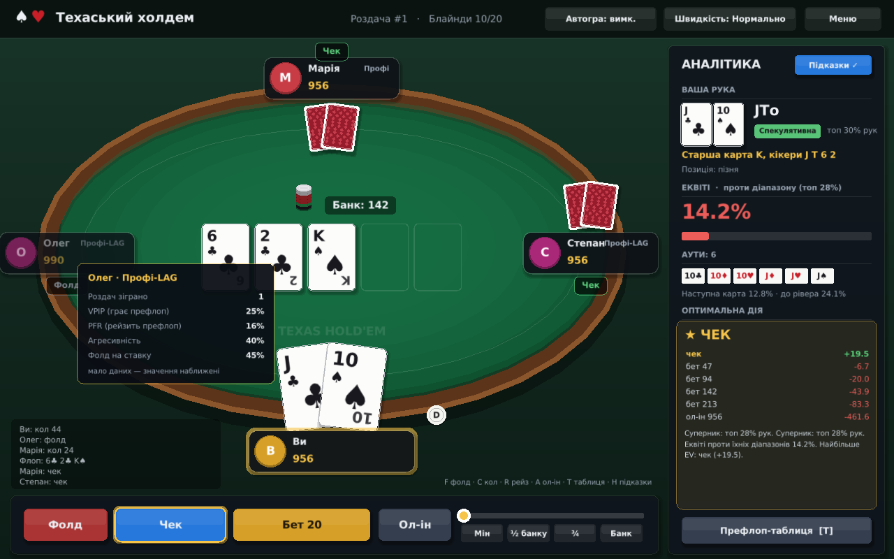
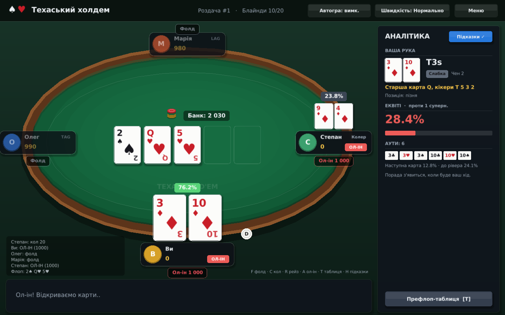
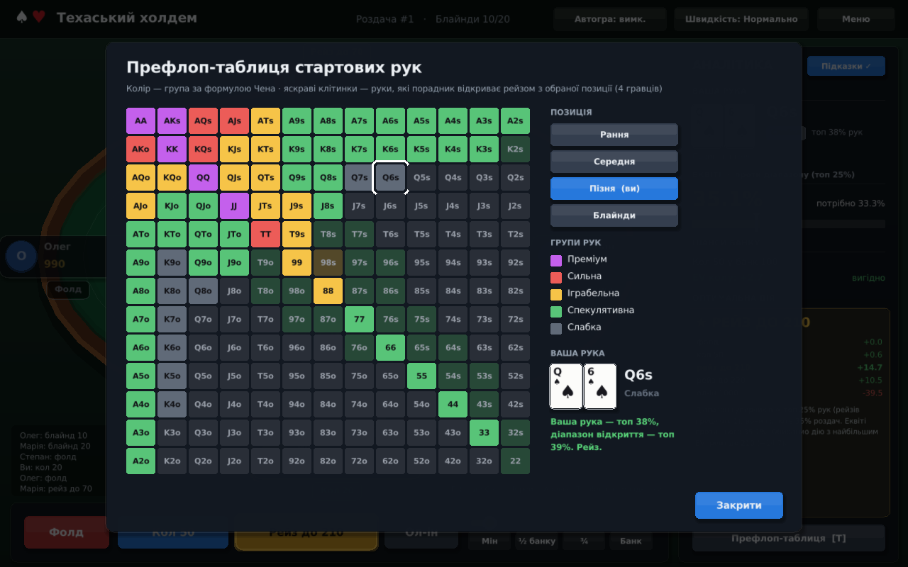
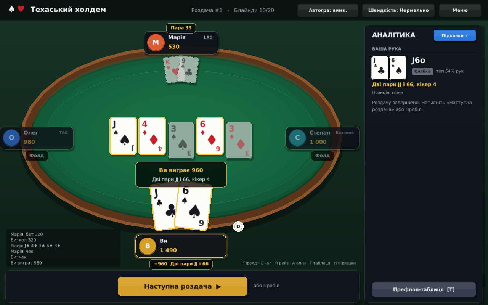

# ♠ ♥ Texas Hold'em — симулятор та аналіз оптимальної стратегії ♦ ♣

Програмна система на **C++17**, яка моделює гру **No-Limit Texas Hold'em** і виконує
ігровий аналіз: еквіті рук, шанси банку, очікуваний виграш (EV), аути, префлоп-таблиці
та порівняння стратегій ботів на тисячах роздач.



Окремий модуль **`cards`** моделює й інші сімейства ігор (преферанс, дурень, блекджек, тисяча, пасьянс):
колоди різних типів, роздавання та ймовірності розкладів методом Монте-Карло. Детальніше —
[docs/TASKS.md](docs/TASKS.md) і програма `cards_lab`.

## Графічна версія (`holdem_gui`)

Справжній покерний стіл з анімаціями роздачі, фішками й аватарами ботів. Уся аналітика
працює **прямо в грі**:

| Під час гри | Що показує |
|---|---|
| **Панель «Аналітика»** (справа) | Сила стартової руки (формула Чена), поточна комбінація, позиція |
| **Еквіті** | Шанси руки проти оціненого діапазону суперників, оновлюються на кожній вулиці |
| **Шанси банку** | Скільки еквіті потрібно для колу та EV колу — «вигідно / невигідно» |
| **Аути** | Карти, що покращують руку, імовірність влучити до рівера |
| **Оптимальна дія** | EV кожної можливої дії (фолд, кол, рейзи, ол-ін) і найвигідніша з них; рекомендована кнопка підсвічується золотим |
| **Префлоп-таблиця** `T` | Сітка 169 рук, ваша рука обведена, діапазон для вашої позиції підсвічено |
| **Ол-ін** | Карти відкриваються, над гравцями — шанси кожного (як у телетрансляціях) |
| **Шоудаун** | Виграшні 5 карт піднімаються й підсвічуються |
| **Рівні ботів** | Легкий (новачки), Середній (TAG/LAG), Складний («Профі»: діапазон і статистика кожного суперника) |
| **Статистика гравців** | Наведіть мишу на гравця — VPIP, PFR, агресивність, фолд на ставку (на собі — "як вас бачать боти") |
| **Автогра** | Порадник грає за вас — зручно для демонстрації (`holdem_gui --demo --level 3`) |

Керування: мишею або клавішами `F` фолд · `C`/`Пробіл` чек/кол · `R` рейз · `A` ол-ін ·
`↑`/`↓`/коліщатко — розмір рейзу · `T` префлоп-таблиця · `H` підказки ·
`Tab` сховати/показати аналітику · `B` суми у великих блайндах (ББ) або у фішках.

| Ол-ін зі шансами | Префлоп-таблиця в грі | Шоудаун |
|---|---|---|
|  |  |  |

## Консольна версія (`holdem`)

| Режим | Що робить |
|---|---|
| **Гра проти ботів** | Повноцінна гра 2–6 гравців: блайнди, 4 раунди торгівлі, ол-іни, сайд-поти, шоудаун. Команда `h` — підказка оптимальної дії |
| **Калькулятор еквіті** | Шанси рук одна проти одної (напр. `AhKh` проти `QsQd`). Точний перебір або Монте-Карло |
| **Аналіз ситуації** | Для заданих карт, борду, банку і ставки — оптимальна дія з поясненням, аути, правило 2 і 4, поріг блефу |
| **Префлоп-таблиця** | Сітка 13×13 усіх 169 стартових рук за формулою Чена і діапазони відкриття за позиціями |
| **Турнір ботів** | 8 стратегій (Профі, Профі-LAG, TAG, LAG, Базовий, Новачок, Колер, Рандом) грають тисячі роздач; bb/100, VPIP, PFR |

## Лабораторія карткових ігор (`cards_lab`)

```bash
./build/app/cards_lab          # меню: beat(), Decks, каре/стріт-флеш, «Гра», преферанс
./build/app/cards_lab --all    # усі задачі одним звітом
```

| Задача | Результат (Монте-Карло) |
|---|---|
| 4 гравці × 5 карт: каре в будь-якій руці | 0,097% (точно ≈ 0,096%) |
| 4 гравці × 5 карт: стріт-флеш | 0,0053% (≈ 0,0055%) |
| Преферанс: 10 взяток без прикупу / з прикупом | 0,011% / 0,50% |
| Преферанс: чистий мізер без прикупу / з прикупом | 0,22% / 5,3% |
| Розклад 4 козирів у суперників 2:2 | 41,9% (точно 41,8%) |

## Швидкий старт

Потрібно: компілятор з підтримкою C++17 (GCC 9+, Clang 10+, MSVC 2019+), CMake 3.16+, git
та інтернет під час першого налаштування (CMake сам завантажить графічну бібліотеку
[raylib](https://www.raylib.com/)).

Проєкт лежить у папці `Cpp_code/` спільного репозиторію
[CardGameStrategy](https://github.com/mecchmatProjects/CardGameStrategy):

```bash
git clone https://github.com/mecchmatProjects/CardGameStrategy.git
cd CardGameStrategy/Cpp_code
cmake -S . -B build -DCMAKE_BUILD_TYPE=Release
cmake --build build --config Release
./build/app/holdem_gui        # графічна версія
./build/app/holdem            # консольна версія
# Windows: build\app\Release\holdem_gui.exe
```

- **macOS:** достатньо `xcode-select --install` і `brew install cmake`.
- **Windows:** Visual Studio 2019+ з компонентом «Desktop development with C++».
- **Linux:** додатково `sudo apt install libxrandr-dev libxinerama-dev libxcursor-dev libxi-dev libgl1-mesa-dev`.
- Без інтернету або без графіки: `cmake -S . -B build -DHOLDEM_BUILD_GUI=OFF` — збереться лише консольна версія.

Тести:

```bash
ctest --test-dir build -C Release --output-on-failure
# або напряму: ./build/tests/poker_tests
```

**CLion / Visual Studio:** просто відкрийте папку проєкту — CMake підхопиться автоматично.

Аргументи командного рядка:

```
holdem --seed 42     # однакові роздачі при кожному запуску (зручно для демонстрації)
holdem --no-color    # без кольорів (якщо термінал не підтримує ANSI)
```

### Формат карт

Ранг: `2`–`9`, `T` (або `10`), `J`, `Q`, `K`, `A`. Масть: `c` ♣, `d` ♦, `h` ♥, `s` ♠.
Приклади: `Ah` — туз чирва, `Td` / `10d` — десятка бубна, `AhKh QsQd` — дві руки.

## Приклад: аналіз ситуації

```
Ваші карти: AhKh      Борд: 7h 2h 9c      Банк: 200     До колу: 100

  ┌─ Аналіз порадника ───────────────────────────
  │ Рука:                     Старша карта A, кікери K 9 7 2
  │ Еквіті:                   57.3%  ███████████░░░░░░░░░
  │ Потрібно (шанси банку):   33.3%
  │ EV колу:                  +71.9 фішок
  │ Аутів:                    15
  │ Оптимальна дія:           КОЛ
  └──────────────────────────────────────────────
Аути (15): 3♥ 4♥ 5♥ 6♥ 8♥ 9♥ 10♥ J♥ Q♥ K♣ K♦ K♠ A♣ A♦ A♠
  Покращення до рівера (2 карти): 54.1%
```

## Структура проєкту

```
Cpp_code/                       # папка нашої команди в репозиторії CardGameStrategy
├── CMakeLists.txt              # кореневий CMake: підключає модулі
├── include/poker/              # публічні заголовки
│   ├── core/                   # Card, Deck, Rng
│   ├── eval/                   # HandEvaluator — оцінка комбінацій
│   ├── game/                   # Game, Player, Action, PotManager, Strategy, GameObserver
│   ├── analysis/               # EquityCalculator, Odds, PreflopChart, HandRanking, Advisor, ExpertAdvisor, BasicAdvisor
│   ├── ai/                     # Bots: Профі, Профі-LAG, TAG, LAG, Базовий, Новачок, Колер, Рандом; рівні складності
│   ├── ui/                     # консоль: Console, ConsoleObserver, HumanStrategy, App
│   ├── cards/                  # PrefCard + beat(), Decks, CardGame («Гра»), задачі про покер і преферанс
│   └── gui/                    # графіка: GameBridge, Render, AnalysisPanel, PokerApp
├── src/<модуль>/               # реалізація + CMakeLists.txt кожного модуля
├── app/                        # main.cpp (консоль), gui_main.cpp (графіка), cards_lab.cpp (задачі про колоди)
├── assets/fonts/               # шрифт DejaVu Sans (кирилиця, символи мастей)
├── tests/                      # юніт-тести (власний міні-фреймворк, без залежностей)
├── docs/
│   ├── TEAM.md                 # ролі, план комітів, git-процес
│   ├── STRATEGY.md             # теорія: еквіті, EV, шанси банку, оптимальна стратегія
│   ├── TASKS.md                # задачі про колоди, покер і преферанс: розв'язки та результати
│   └── screenshots/            # знімки екрана для README
└── (у корені репозиторію) .github/workflows/cpp.yml — збірка і тести Cpp_code (Linux + Windows)
```

## Архітектура

Кожен модуль — окрема статична бібліотека; залежності йдуть строго знизу вгору:

```
          ┌──────────┐
          │  app     │  main.cpp, gui_main.cpp
          └────┬─────┘
       ┌───────▼──────────┐
       │  ui   │   gui    │  консоль │ графіка (raylib)
       └───────┬──────────┘
          ┌────▼─────┐
          │  ai      │  боти (стратегії)
          └────┬─────┘
          ┌────▼─────┐
          │ analysis │  еквіті, шанси банку, порадник
          └────┬─────┘
          ┌────▼─────┐
          │  game    │  рушій роздачі, банки
          └────┬─────┘
          ┌────▼─────┐
          │  eval    │  оцінка комбінацій
          └────┬─────┘
          ┌────▼─────┐
          │  core    │  карти, колода
          └──────────┘
```

Використані патерни проєктування:

- **Strategy** — `Strategy` визначає "мозок" гравця. Рушій гри не знає, хто ходить: бот чи людина.
- **Observer** — `GameObserver` отримує події гри. Рушій нічого не друкує сам: консоль,
  статистика симуляції й тести просто підписуються на події.
- **Factory Method** — `makeBot(BotType, seed)` створює бота потрібного типу.
- **Value Object** — `Card`, `HandValue`, `Action` — легкі незмінні значення.
- **Producer–Consumer** — у графічній версії рушій гри працює в окремому потоці й передає
  події через потокобезпечну чергу (`GameBridge`); графіка програє їх з анімаціями, а хід людини
  повертається назад через `condition_variable`. Рушій для цього не довелося змінювати.

Ключові алгоритми:

- **Оцінка руки** (`eval/`) — бітові маски рангів і мастей, без перебору 21 комбінації;
  результат пакується в одне число `score`, тож руки порівнюються одним `<`.
- **Сайд-поти** (`game/PotManager`) — розбиття внесків на рівні за ол-інами.
- **Еквіті** (`analysis/EquityCalculator`) — повний перебір бордів, якщо варіантів ≤ 2 млн,
  інакше метод Монте-Карло з частковим перемішуванням Фішера–Єйтса.
- **Порадник** (`analysis/Advisor`) — оцінює діапазони суперників за їхніми діями та профілем
  (VPIP, агресивність), рахує еквіті проти діапазону і обирає дію з **максимальним EV**
  з урахуванням fold equity; короткий стек — "ол-ін або фолд". Перша, простіша версія
  збережена як `BasicAdvisor` (бот «Базовий»): новий TAG обігрує її на ≈ +340 bb/100.
- **«Профі»** (`analysis/ExpertAdvisor`) — діапазон кожного суперника окремо по ходу роздачі,
  його особиста статистика (VPIP, PFR, fold to bet), implied odds, цінність майбутніх вулиць,
  дисципліна стеку; за столом на 6 гравців «Профі» і «Профі-LAG» — єдині в плюсі.
  Детально — у [docs/STRATEGY.md](docs/STRATEGY.md).

## Команда

Розподіл ролей, план комітів і правила роботи з репозиторієм — у [docs/TEAM.md](docs/TEAM.md).
